<div align="center">

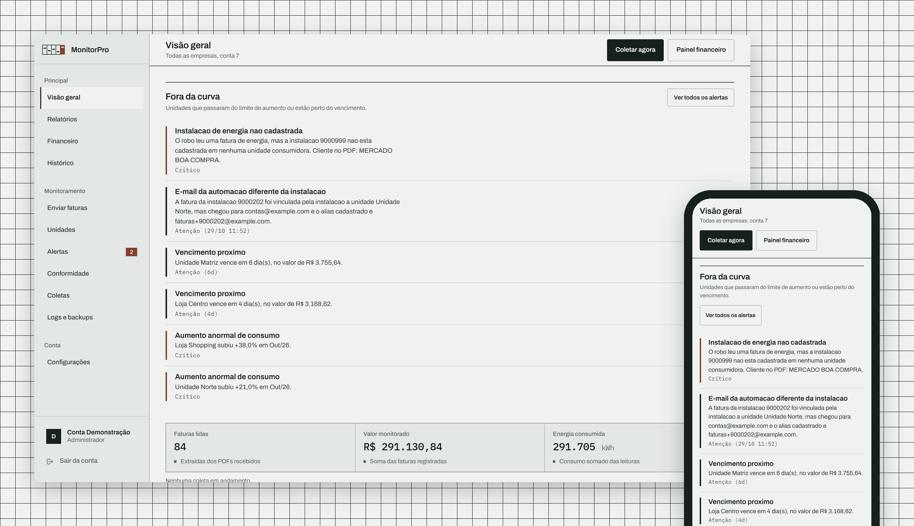

# MonitorPro

**Monitoramento de contas de energia elétrica, com segurança da informação e LGPD tratadas no código, não no discurso.**


</div>

> **Tudo o que aparece aqui é fictício.** As telas foram capturadas de uma base
> gerada pelo comando `popular_demo`: empresas inventadas, instalações `9000xxx`,
> e-mails em `example.com` e IPs das faixas reservadas para documentação. Nenhuma
> fatura, nome ou número de instalação real está no código, nas imagens ou no
> histórico deste repositório.

---

## O que é

Empresas com várias unidades consumidoras (lojas, clínicas, condomínios, fábricas)
recebem a conta de luz de cada uma por e-mail, em PDF. Conferir uma a uma é lento,
e um aumento anormal de consumo só aparece quando o boleto já foi pago.

O MonitorPro **lê essas faturas sozinho**, extrai titular, instalação, vencimento,
valor, consumo e leituras do medidor, compara cada conta com a anterior da mesma
instalação e **avisa quando algo sai da curva**: alta acima do limite, vencimento
próximo, fatura de instalação desconhecida.

- **Coleta automática** por IMAP, ou envio manual de até 20 PDFs de uma vez
- **Leitura de layouts CPFL e Elektro**, inclusive a fonte embaralhada da Elektro,
  decodificada por mapa de glifos
- **Multiempresa**, com papéis de administrador, operador e leitura
- **Relatórios** com maiores altas e quedas, painel financeiro e exportação em PDF e CSV
- **Alertas** por e-mail e WhatsApp

## Como funciona

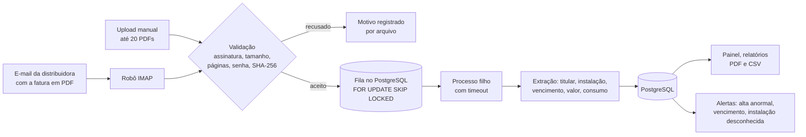

Cada PDF é processado num **processo filho descartável**: se o parser travar ou
estourar a memória, o worker mata o processo e só aquele arquivo falha. A fila
vive no próprio PostgreSQL, sem Redis nem Celery para manter no ar.

## Telas

| Visão geral | Relatório |
|---|---|
| 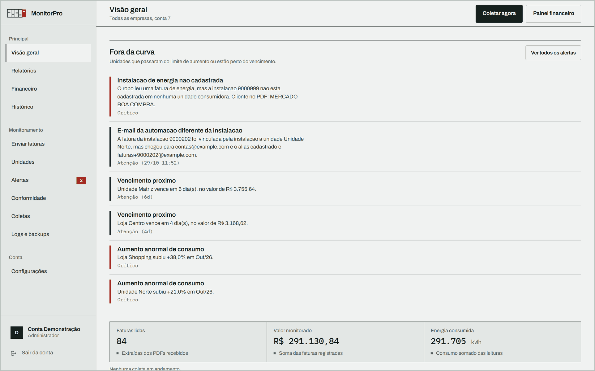 | 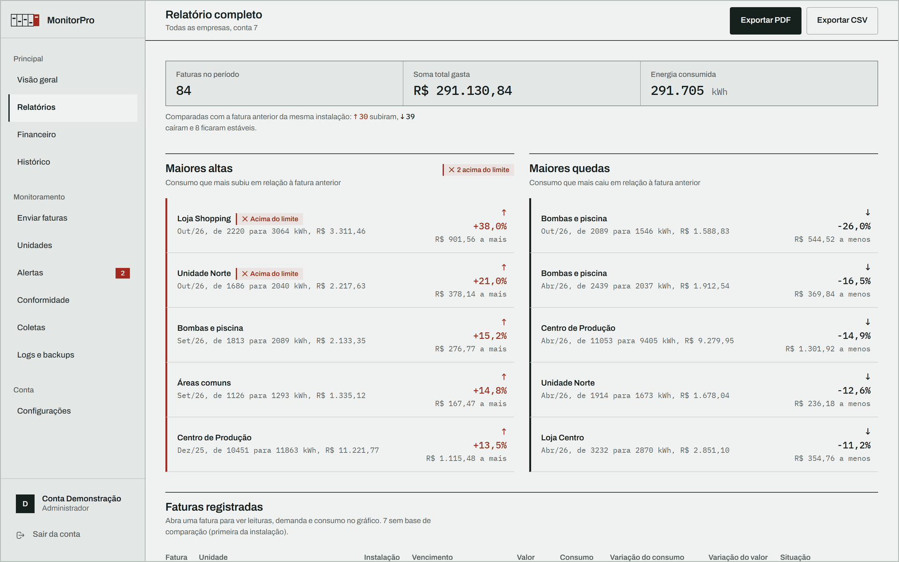 |
| **Detalhe da fatura** | **Painel financeiro** |
| 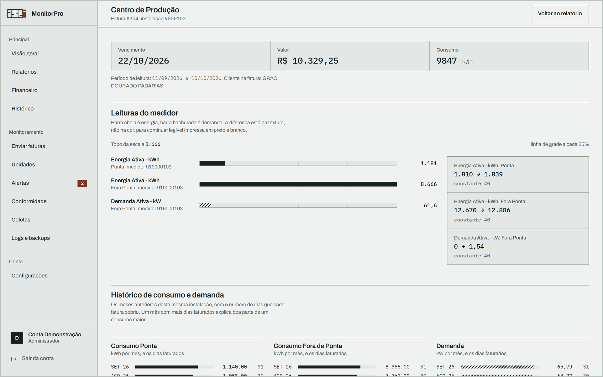 | 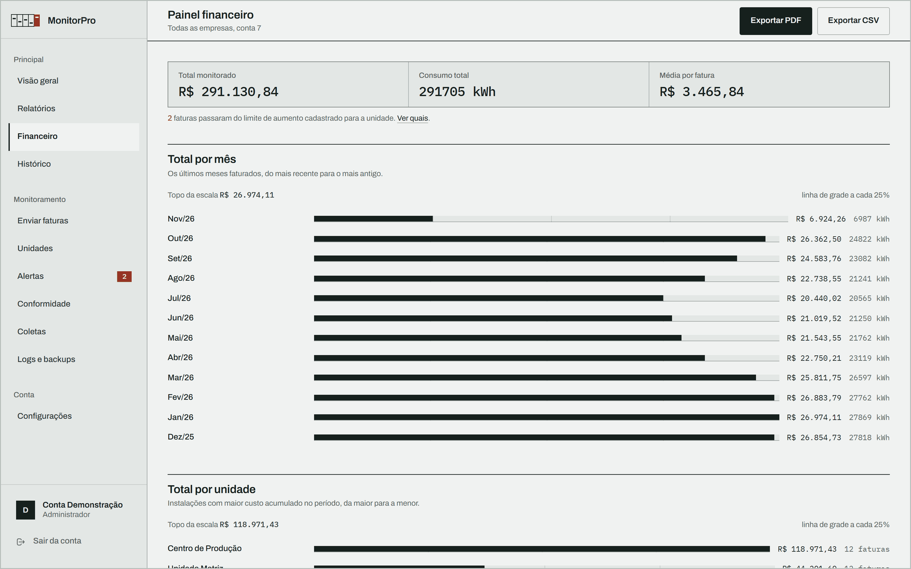 |

<details>
<summary><strong>Mais telas</strong>: unidades, upload em lote, celular e visão de cliente</summary>

| Unidades consumidoras | Upload em lote |
|---|---|
| 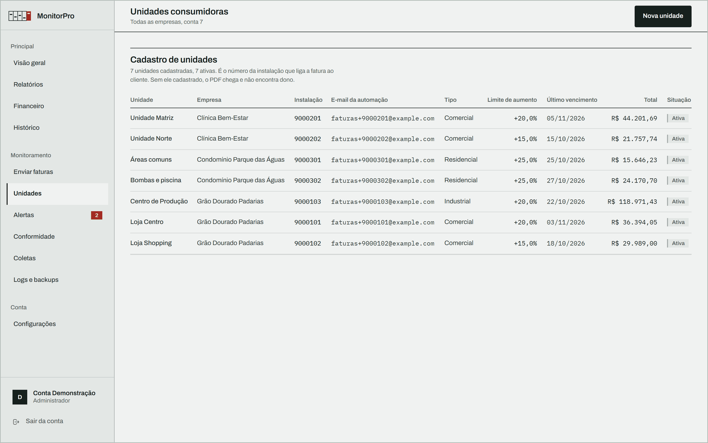 | 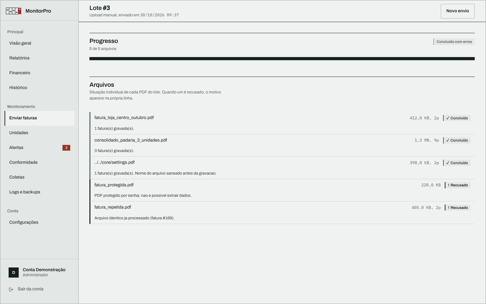 |
| **Cliente com papel de leitura** | **Celular** |
| 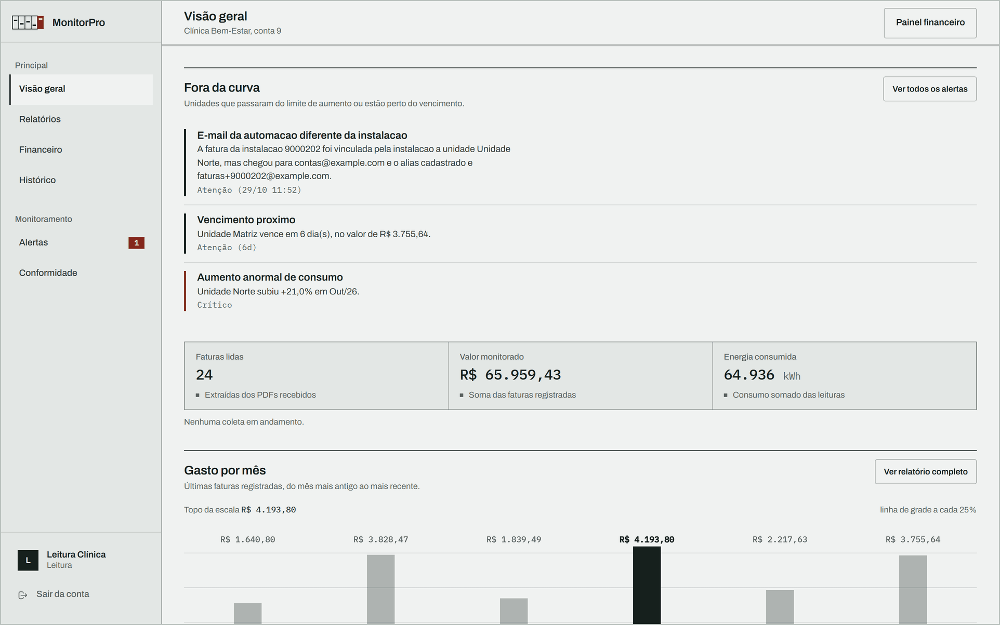 | 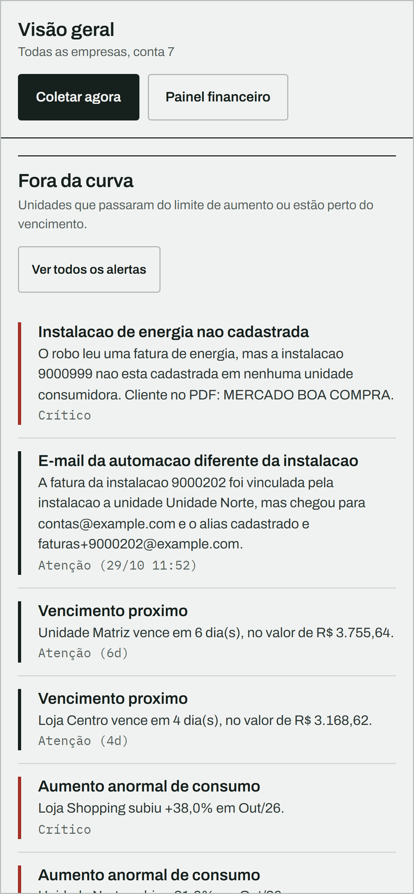 |

</details>

---

## Segurança da informação

O projeto passou por **três rodadas de revisão de segurança**, com **26 correções
documentadas** (5 críticas, 10 altas e 11 médias). Cada correção de vulnerabilidade
tem um teste automatizado que falhava antes e passa depois. O relatório completo,
com o problema, a correção e a verificação de cada item, está em
[`docs/SEGURANCA.md`](docs/SEGURANCA.md).

| Ameaça | Defesa | Onde |
|---|---|---|
| Força bruta no login | Rate limit em duas camadas (10 tentativas por origem em 5 min, 8 por conta em 15 min) num cache compartilhado entre processos, que **nega** a operação se o cache cair. O login do admin do Django não tem formulário próprio: vai para a mesma tela protegida | `views.tela_login`, `admin.py` |
| Senha vazada do banco | Argon2id, mínimo de 12 caracteres e validadores de senha comum | `settings.py` |
| XSS | CSP estrita, sem `unsafe-inline` em scripts e sem nenhum `\|safe` nos templates | `middleware.py` |
| Clickjacking, *sniffing*, cache | `X-Frame-Options: DENY`, `frame-ancestors 'none'`, `nosniff`, COOP, CORP, Permissions-Policy e `no-store` nas telas autenticadas | `middleware.py` |
| Sequestro de sessão | Cookie `HttpOnly`, `Secure` e `SameSite`, CSRF na sessão, expiração em 8 h e HSTS de 1 ano | `settings.py` |
| PDF malicioso | Assinatura `%PDF-` conferida pelo conteúdo, limites de tamanho e de páginas, recusa de PDF com senha, *timeout* em processo isolado | `seguranca.validar_pdf`, `worker_pdf.py` |
| *Path traversal* | Nome do anexo saneado e gravação confinada ao diretório depois de resolver *symlinks* (`../../core/settings.py` vira `settings_7e95b523.pdf`) | `seguranca.nome_arquivo_seguro` |
| SSRF no webhook | Só `https`, só host público (bloqueia `169.254.169.254`, loopback e rede privada) e sem seguir *redirect* | `seguranca.validar_url_webhook` |
| Vazamento entre clientes | Toda consulta é filtrada pela empresa do usuário; backup do sistema só para superusuário | `views.faturas_base` |
| Injeção em exportação | Fórmula neutralizada no CSV (`=HYPERLINK(...)`) e marcação escapada no PDF (`<a href>`) | `views.texto_csv`, `views.texto_pdf` |
| Configuração insegura | Nenhum segredo tem valor padrão: com `DEBUG=False`, a aplicação **se recusa a subir** sem `SECRET_KEY`, `ALLOWED_HOSTS` e `DB_PASSWORD` | `settings.py` |
| Fatura duplicada ou adulterada | SHA-256 de cada PDF, `INSERT ... ON CONFLICT` atômico e gravação numa transação só | `robo_leitor_cpfl.py` |
| Ação sem rastro | Auditoria de quem fez o quê, de onde e quando, mais o valor anterior e o novo de cada campo alterado | `AuditoriaEvento`, `RegistroAlteracao` |
| Dependência vulnerável | Versões fixadas, `pip-audit` na CI a cada push e toda semana, Dependabot | `requirements.txt`, `.github/` |

**Um ataque de força bruta, do lado de quem ataca e do lado de quem audita:**

| Bloqueio na tela de login | Registro na trilha de auditoria |
|---|---|
| 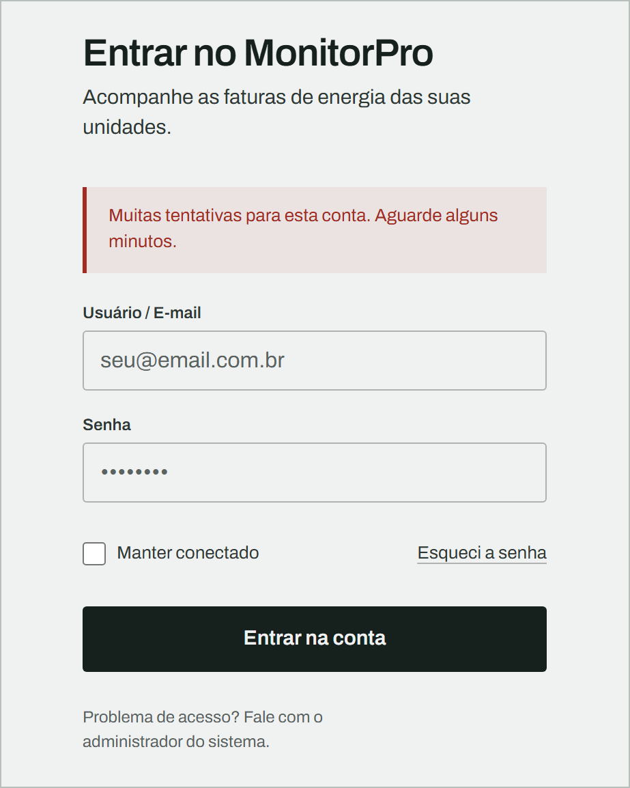 | 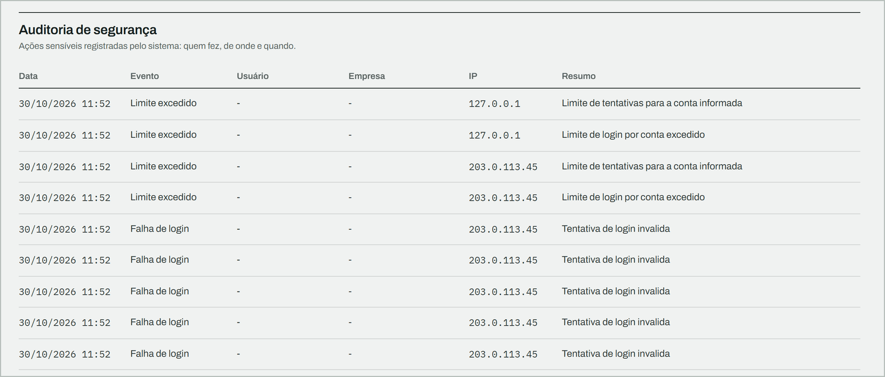 |

### Verificação contínua

A cada push, o GitHub Actions roda:

- os **37 testes** contra um PostgreSQL de verdade;
- `manage.py check --deploy` com configuração de produção;
- **pip-audit**, que procura vulnerabilidades conhecidas nas dependências;
- **bandit**, a análise estática de segurança do código Python;
- **gitleaks**, que procura segredos em todo o histórico do Git;
- **CodeQL**, a análise semântica de código do GitHub.

Para relatar uma vulnerabilidade, veja a [política de segurança](SECURITY.md).

---

## LGPD

Fatura de energia é dado pessoal: tem nome do titular, endereço e hábitos de
consumo. O sistema foi construído em torno disso.

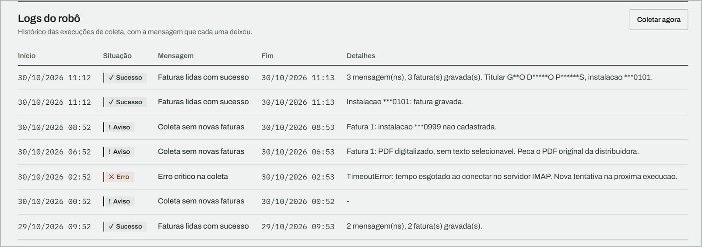

- **Log sem dado pessoal em claro.** Nome, e-mail, CPF/CNPJ e instalação são
  mascarados na origem (`G**O D*****O P******S`, `***0101`). O dado íntegro fica
  só no banco, atrás de controle de acesso.
- **Retenção com prazo.** O PDF processado com sucesso é apagado na hora; o que
  falhou é expurgado em 90 dias pelo comando `expurgar_pdfs`, que registra na
  auditoria o que removeu.
- **Necessidade.** Do PDF sai só o que a comparação usa. O arquivo não é guardado
  depois de lido.
- **Acesso mínimo.** Papéis por empresa; backups, que contêm todos os clientes,
  só para superusuário.
- **Prestação de contas.** Auditoria de acesso e de alteração, com o valor
  anterior e o novo de cada campo.
- **Segredo nunca em auditoria.** Senha e token são removidos antes de gravar,
  inclusive quando alguém digita a senha no campo de usuário.

O inventário dos dados, as bases de retenção, o atendimento aos direitos do
titular, o roteiro de incidente e os riscos residuais estão em
[`docs/LGPD.md`](docs/LGPD.md).

---

## Rodando localmente

**Requisitos:** Python 3.13 e PostgreSQL 15 ou mais novo (testado no 17 e no 18).

```bash
git clone https://github.com/KauanTrinchetti/monitorpro.git
cd monitorpro
python -m venv .venv
source .venv/bin/activate            # Windows: .venv\Scripts\activate
python -m pip install -r requirements.txt
```

Crie um banco vazio (por exemplo `monitorpro`) e um arquivo `.env` na raiz:

```ini
DEBUG=True
DB_NAME=monitorpro
DB_USER=postgres
DB_PASSWORD=sua-senha-local
```

Depois:

```bash
python manage.py migrate
python manage.py createcachetable
python manage.py popular_demo        # dados fictícios; mostra as senhas geradas uma única vez
python manage.py runserver
```

Abra `http://127.0.0.1:8000/` e entre com o usuário `demo`.

> Em desenvolvimento, sem `SECRET_KEY` no `.env`, uma chave temporária é gerada a
> cada inicialização. Para produção, siga [`docs/DEPLOY.md`](docs/DEPLOY.md):
> `.env.example` lista todas as variáveis.

### Testes

```bash
python manage.py test monitor
```

## Stack

| Camada | Tecnologia |
|---|---|
| Aplicação | Python 3.13, Django 6.0 |
| Banco e fila | PostgreSQL (`SELECT ... FOR UPDATE SKIP LOCKED`), cache de rate limit no banco |
| Leitura de PDF | pdfplumber, pdfminer.six e pypdfium2, com processo filho e *timeout* |
| Relatórios | reportlab (PDF) e CSV compatível com Excel em português |
| Senhas | Argon2id (`argon2-cffi`) |
| Interface | Templates Django e CSS próprio (design system com tokens, contraste AA medido e *mobile-first*), sem framework de JavaScript |

## Estrutura

```text
core/                    configuração: segurança, CSP, sessão, cache, logging
monitor/
  seguranca.py           defesas compartilhadas (PDF, path traversal, SSRF, mascaramento)
  middleware.py          cabeçalhos de segurança em toda resposta
  views.py               telas, exportações e controle de acesso por empresa
  fila.py                fila de PDFs no PostgreSQL
  worker_pdf.py          extração em processo filho
  management/commands/   coleta, fila, backup, restauração, expurgo e popular_demo
  tests.py               37 testes de renderização, segurança e isolamento
robo_leitor_cpfl.py      robô IMAP e extratores CPFL e Elektro
docs/                    segurança, LGPD, guia de uso e deploy
```

## Documentação

| Documento | Conteúdo |
|---|---|
| [`docs/SEGURANCA.md`](docs/SEGURANCA.md) | Relatório técnico: cada vulnerabilidade, a correção e como foi verificada |
| [`docs/LGPD.md`](docs/LGPD.md) | Dados pessoais tratados, retenção, direitos do titular e incidentes |
| [`docs/GUIA.md`](docs/GUIA.md) | Manual de uso e de manutenção |
| [`docs/DEPLOY.md`](docs/DEPLOY.md) | Implantação em servidor e rotinas agendadas |
| [`SECURITY.md`](SECURITY.md) | Como relatar uma vulnerabilidade |

## Limitações conhecidas

- Sem segundo fator de autenticação, que é o próximo passo para as contas de
  superusuário.
- O robô lê uma caixa de e-mail por vez, e o extrator conhece os layouts CPFL e
  Elektro. Fatura escaneada, sem texto, é recusada com orientação para pedir o PDF
  original.
- As fontes vêm do Google Fonts, o que expõe o IP de quem acessa a um terceiro.
  Servi-las junto com a aplicação está entre os próximos passos (ver
  [`docs/LGPD.md`](docs/LGPD.md)).

## Licença

Todos os direitos reservados. O código está aberto para leitura e avaliação; para
outros usos, abra uma *issue*.
